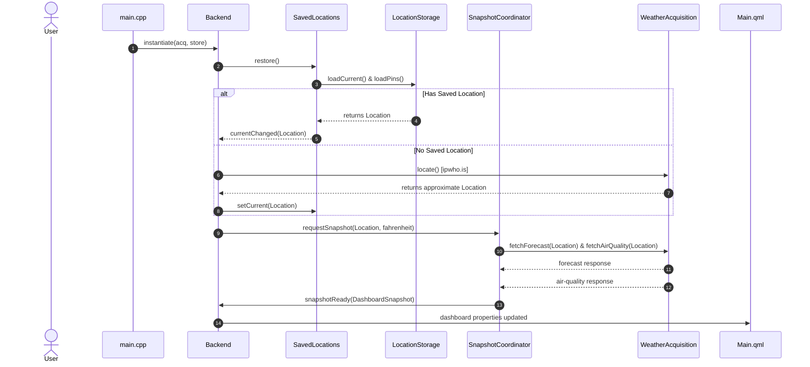
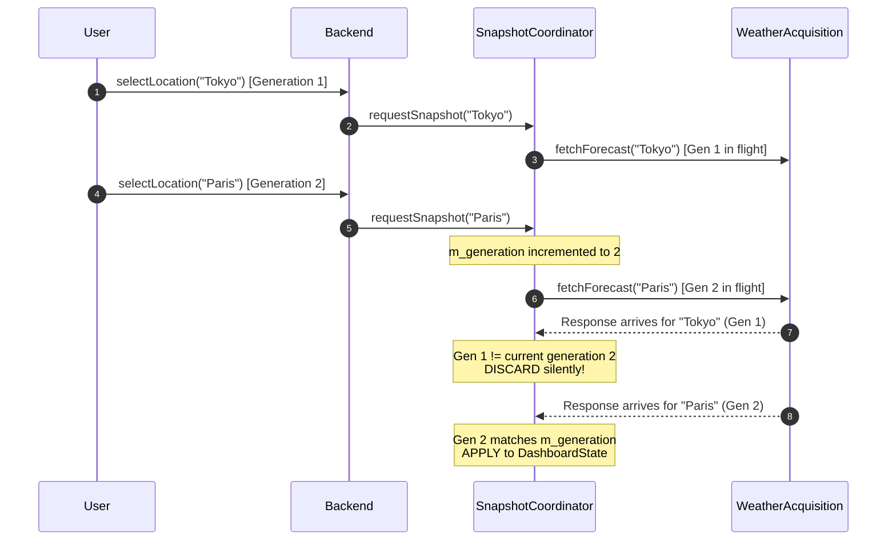

# Weatherdeck Architecture

This document describes the architectural design, module boundaries, data flows, and extension seams of Weatherdeck.

## 1. Architectural Overview

Weatherdeck is built around a layered architecture designed for testability, deterministic state, and clear separation of concerns. The Qt Quick presentation layer interacts exclusively with a lean mediator (`Backend`), which coordinates domain logic, snapshot retrieval, and persistent location bookmarks through abstract seams.

```mermaid
flowchart TD
    subgraph UI ["Presentation Layer (Qt Quick / QML)"]
        MainQML["Main.qml\n(Layout, shortcuts, theme)"]
    end

    subgraph Mediator ["Presentation Mediator"]
        Backend["Backend (QObject Facade)\n- dashboard: DashboardState*\n- searchResults: QVariantList\n- actions: refresh, search, select, units, pins"]
    end

    subgraph Domain ["Domain & State Layer"]
        DashboardState["DashboardState (QObject)\n- locationName, updated, status\n- loading, fahrenheit, pinned\n- current: CurrentConditions (Q_GADGET)\n- airQuality: AirQuality (Q_GADGET)\n- hourly: QList<HourlyForecast>\n- daily: QList<DailyForecast>"]
        SnapshotCoord["DashboardSnapshotCoordinator\n- generation counter\n- coordinates forecast + AQ\n- discards stale generations\n- handles partial failures"]
        SavedLocations["SavedLocations\n- current selected Location\n- pins: QList<Location>\n- normalized-key deduplication (%.4f, %.4f)\n- cycling & persistence"]
        DashboardParser["Dashboard Parser & Models\n- Open-Meteo forecast parser\n- Air-quality parser\n- Series alignment validator\n- Weather code & glyph mapper"]
    end

    subgraph Seams ["Abstract Seams"]
        WeatherAcquisition["<<interface>> WeatherAcquisition\n+ fetchForecast(Location, fahrenheit, cb)\n+ fetchAirQuality(Location, cb)\n+ locate(cb)\n+ search(query, cb)"]
        LocationStorage["<<interface>> LocationStorage\n+ loadCurrent(), saveCurrent(Location)\n+ loadPins(), savePins(QList<Location>)\n+ loadFahrenheit(), saveFahrenheit(bool)"]
    end

    subgraph Adapters ["Concrete Adapters"]
        QtAcq["QtWeatherAcquisition\n(Open-Meteo & ipwho.is via QNetworkAccessManager)"]
        FakeAcq["FakeWeatherAcquisition\n(Deterministic in-memory mock for tests)"]
        QSettingsStore["QSettingsLocationStorage\n(omarchy/weatherdeck via QSettings)"]
        MemoryStore["InMemoryLocationStorage\n(Isolated in-memory store for tests)"]
    end

    MainQML -->|Binds properties & triggers actions| Backend
    Backend -->|Owns & updates| DashboardState
    Backend -->|Requests snapshots on changes| SnapshotCoord
    Backend -->|Delegates bookmarking & cycling| SavedLocations
    Backend -->|Dispatches debounced search| WeatherAcquisition

    SnapshotCoord -->|Parses payloads| DashboardParser
    SnapshotCoord -->|Fetches network data| WeatherAcquisition
    SavedLocations -->|Persists bookmarks & selection| LocationStorage

    WeatherAcquisition <|.. QtAcq
    WeatherAcquisition <|.. FakeAcq
    LocationStorage <|.. QSettingsStore
    LocationStorage <|.. MemoryStore
```

---

## 2. Module Responsibilities

### Presentation Layer (`src/Main.qml`)
- Declarative Qt Quick user interface with dark theme and monospace typography.
- Owns keyboard navigation (`/` search, `r` refresh, `c`/`f` units, `p` pin, `Tab`/`Shift+Tab` cycle, `?` help, `q` quit).
- Binds directly to `backend.dashboard` and its structured sub-properties (`current`, `airQuality`, `hourly`, `daily`).
- Contains zero network, persistence, or parsing logic.

### Presentation Mediator (`src/backend.*`)
- The single QML-facing facade registered as a context property (`backend`).
- Exposes:
  - `dashboard`: Read-only pointer to `DashboardState`.
  - `searchResults`: List of geocoded search results.
  - User actions: `refresh()`, `search()`, `selectSearchResult()`, `toggleUnits()`, `togglePin()`, `cyclePin()`.
- Wires signals between `SavedLocations`, `DashboardSnapshotCoordinator`, and `DashboardState`.
- Implements dependency injection for zero-network testing.

### Domain Models & Parser (`src/location.*`, `src/dashboard_model.*`, `src/dashboard_state.*`)
- **`Location`**: Geographic place identity defined by fixed-precision coordinates (`lat`, `lon` at 4 decimal places). Implements deduplication and equality checking.
- **`CurrentConditions`**: Typed gadget containing temperature, apparent temperature, humidity, precipitation, wind speed/direction, weather code, descriptive text, and weather glyphs.
- **`HourlyForecast` & `DailyForecast`**: Typed gadgets for time-series projections. Includes alignment validation across parallel arrays (`time`, `temperature_2m`, `precipitation_probability`, `weather_code`, `relative_humidity_2m`, `uv_index`) to guard against truncated or malformed responses.
- **`AirQuality`**: Explicit availability tracking (`available = true/false`) with European AQI and PM2.5 metrics.
- **`DashboardState`**: `QObject` holding the active display snapshot and emitting granular updates.

### Dashboard Snapshot Coordinator (`src/dashboard_snapshot.*`)
- Coordinates the acquisition of forecast and air quality data for a given `Location` and temperature unit.
- Implements **generation tracking** (`m_generation`) to drop stale network responses if the user rapidly switches locations or toggles units.
- Implements **graceful degradation**: if the air-quality service is down or returns an error, the forecast is preserved and emitted with `airQuality.available = false`.

### Saved Locations (`src/saved_locations.*`)
- Manages bookmarks (pins) and the currently selected location.
- Enforces deduplication using `Location::normalizedKey()`.
- Implements wrap-around cycling (`cyclePin(+1)` and `cyclePin(-1)`).
- Interacts strictly with the abstract `LocationStorage` seam.

### Acquisition Seam (`src/weather_acquisition.*`)
- **`WeatherAcquisition`**: Abstract interface for all external HTTP communication.
- **`QtWeatherAcquisition`**: Production adapter executing asynchronous requests against Open-Meteo forecast, Open-Meteo air quality, Open-Meteo geocoding, and ipwho.is.
- **`FakeWeatherAcquisition`**: Test adapter providing canned responses, manual trigger controls, and failure simulation without opening network sockets.

### Storage Seam (`src/saved_locations.*`)
- **`LocationStorage`**: Abstract interface for settings persistence.
- **`QSettingsLocationStorage`**: Production adapter reading and writing to `~/.config/omarchy/weatherdeck.conf`.
- **`InMemoryLocationStorage`**: Test adapter holding state purely in RAM.

---

## 3. Key Data Flows

### Application Startup & Location Acquisition



### Generation Tracking & Stale Discard



---

## 4. Source File Layout

```
weatherdeck/
├── bin/
│   ├── build                 # Compiles with qmake6 & make
│   ├── install               # Builds Arch package & installs via makepkg
│   └── test                  # Compiles and runs test suite
├── pkgbuild/
│   ├── PKGBUILD              # Arch Linux package recipe
│   ├── weatherdeck.desktop   # App launcher entry
│   └── weatherdeck.svg       # Application vector icon
├── src/
│   ├── main.cpp              # Application entry point & QML engine setup
│   ├── Main.qml              # Presentation view & keybindings
│   ├── resources.qrc         # QML and translation resource bundle
│   ├── theme.h / .cpp        # Omarchy system theme integration
│   ├── translator.h / .cpp   # Dynamic localization engine
│   ├── location.h / .cpp     # Geographic Location domain entity
│   ├── dashboard_model.h / .cpp # Parsers, glyphs, and typed forecast gadgets
│   ├── dashboard_state.h / .cpp # QObject state container for QML
│   ├── dashboard_snapshot.h / .cpp # Snapshot coordination & generation manager
│   ├── saved_locations.h / .cpp # Bookmark manager & LocationStorage seam
│   ├── weather_acquisition.h / .cpp # WeatherAcquisition seam & Qt/Fake adapters
│   └── backend.h / .cpp      # Presentation mediator facade
└── tests/
    ├── weatherdeck_tests.pro # Test target configuration
    └── weatherdeck_tests.cpp # Comprehensive automated test suite
```
