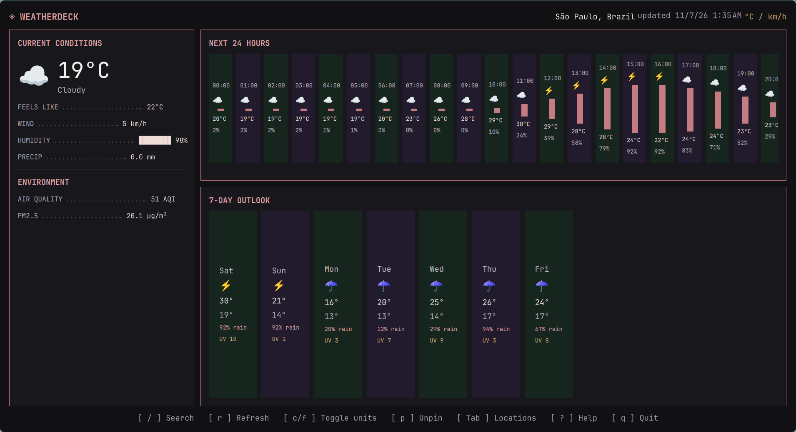

# Weatherdeck

A keyboard-first weather dashboard for Omarchy. It uses Open-Meteo for weather, city search, and air quality; first launch uses approximate IP location.

| Key | Action |
| --- | --- |
| `/` | Search location |
| `r` | Refresh |
| `c` / `f` | Toggle units |
| `p` | Pin current city |
| `Tab` | Cycle pinned cities |
| `?` | Show help |
| `q` | Quit |
